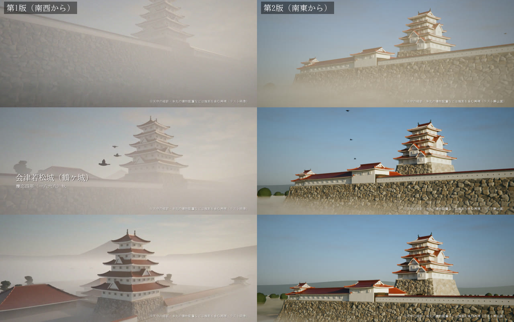

# 会津若松城（鶴ヶ城）1868 ― 映画風テストショット

「朝霧の中から、慶応四年（1868年）当時の会津若松城の天守が現れる」8秒のショットを、Blenderのスクリプト1本で作ります。外部の素材や有料サービスは使いません。

- 画面比率：2.39:1（シネスコ）、24fps、192コマ（8秒）
- 描く範囲：内堀の水面と川霧、本丸の石垣（野面積み）、天守台と入口、五重の天守、走長屋・鉄門・南走長屋・干飯櫓、狭間のある土塀、本丸御殿（石垣の陰）、松、朝日、高い雲、遠景の山並み、盆地の霧、霧の上を横切るカラス
- カメラ：天守の**南東**、内堀の水面近く（高さ2.2m、霧の中）から、1カットで高さ19mまでゆっくり上昇する。レンズは40mmで固定（ズームしない）、ピントは天守に合わせ続ける
- 大阪城のスクリプト（`../osaka-castle/`）とは独立していて、あちらは変更していません

## 静止画（第2版・確認用）

| ファイル | 内容 |
|---|---|
| `test/v2/aizu_v2_f0001.png`・`f0096`・`f0192` | 1・96・192コマ目（960×402）。色調整と「推測を含む」の注記入り |
| `test/v2/aizu_v2_raw_f0001.png` など | 同じコマの、色調整前の描画そのまま |
| `test/v2/aizu_v2_compare.jpg` | 第1版（左）と第2版（右）の同じコマの比較 |



**描画時間**（クラウドのCPU 4コア・GPUなし、TEST＝960×402・最大64サンプル・モーションブラーあり）：1コマ目 93.8秒、96コマ目 58.7秒、192コマ目 48.0秒、平均66.8秒。8秒（192コマ）全体では約3.6時間の見込みです（第1版は32サンプルで1コマ平均26.5秒）。カメラが霧の中にある前半ほど重く、時間の大半は霧の計算です。

**明るさの幅**（色調整後、画面で最も暗い1%の明るさ。0＝黒、255＝白）：96コマ目 37、192コマ目 34（第1版は152・90）。1コマ目はカメラが霧の中にあるため116（第1版124）。

## 次回の再開（A案：残る問題を直し、静止画3枚で再確認）

第2版の静止画で残っている問題（優先順）：
1. 石垣：石が丸く大きさがそろい、ゲームの素材のように見える（`stone_relief`・`Ishigaki` マテリアル）
2. 空と光：雲がほとんどなく、霧の上に出ると朝の空気感が消える（`build_world` の `CloudAmount`、霧・かすみの濃さ）
3. 質感：白壁・赤瓦がきれいすぎる（雨じみ・汚れ・苔が足りない。`Shikkui`・`Akagawara` マテリアル）
4. 大きさの手がかりがない（人・炊煙など）。カラス3羽が一直線に並ぶ（`build_birds`）
5. 1コマ目の霧がやや砂色（第2版は色調整で補正）

確認の手順：
1. スクリプトを直したら、`--quality TEST --benchmark` で1・96・192コマ目だけを描く（クラウドのCPUで約4分）
2. 下の色調整をかけて `test/v3/` に保存し、第2版と並べて比べる
3. 8秒全体（約3.6時間）は、静止画を確認してから描く

静止画の色調整（ffmpeg。第2版と同じ設定）：
```sh
ffmpeg -i benchmark_0001.png -vf "colortemperature=temperature=7600:mix=0.55:pl=1,curves=m='0/0 0.18/0.13 0.5/0.49 0.82/0.86 1/1',eq=saturation=1.06,vignette=angle=PI/9,noise=alls=2:allf=u" -pix_fmt rgb24 aizu_v3_f0001.png
```
右下の注記「※天守の細部・本丸の建物配置などは推測を含む再現（テスト静止画）」は、`drawtext`（明朝体、高さの3%、右下）で入れる。

## 第1版のテスト映像

| ファイル | 内容 |
|---|---|
| `test/aizu_kiri_test_960x402.mp4` | 第1版の低解像度テスト映像（960×402・24fps・8秒・無音）。南西からのカメラ |
| `test/aizu_kiri_test_contact.jpg` | 第1版の1秒ごとのコマの一覧 |

再生方法：Windowsではエクスプローラーで `aizu-castle\test\aizu_kiri_test_960x402.mp4` をダブルクリックすると「メディア プレーヤー」で再生されます。GitHubでは `aizu-castle/test/` でファイルを選び「View raw」か「Download」を押します。

## 第1版がCGに見えた原因と、第2版での直し方

| 見え方 | 原因（第1版のコード） | 第2版 |
|---|---|---|
| 全体が白っぽく黒がない | 霧が濃さに比例して自ら光る近似（FogGlow）。光の向きと無関係に明るくなり、陰影が消えた | 発光をやめ、太陽と空の光の散乱だけで描く |
| 霧が一様な白いもや | Cycles は手続き的な霧を「箱の平均の大きさの1/10」ごとにしか調べない。6km四方の箱では約400mおきで、霧の塊や筋が消えていた | 霧を城のまわり（1.3km四方・高さ17m）に限り、調べる間隔を2.5m（4Kでは1m）に指定 |
| 霧が濃すぎる・前後の差がない | 一つの箱・一つの濃さで前景から遠景まで | 堀の川霧（上端約10m、切れ間と筋あり）・盆地の霧（地表から約9m）・大気のかすみ（高さ約500m）の3層 |
| 天守の比率が違う | 天守台8m、天守約30m、最上重が長方形 | 資料に合わせて天守台11m、天守25.15m、最上重は五間四方 |
| 屋根が大陸風・模型風 | 軒反りが隅だけ跳ね上がる曲線（4乗）。屋根の帯が壁より厚い | なだらかな軒反り（2.2乗）。どの重も屋根勾配を約5寸にそろえ、壁の帯を高くした |
| 形が単純な箱 | 窓は黒い箱に縦格子4本、鬼瓦は立方体、鯱は球3つ、懸魚は板 | 窓は白い塗籠の枠と格子7本・奥行きあり、熨斗積みの棟と鬼瓦、鯱・懸魚の形、入母屋の妻と破風板 |
| 光が作り物っぽい | 太陽の色を手作りの式で決めていた | 太陽の色を大気の透過率（空気の分子＋もや）から計算 |
| 模型を見下ろす感じ | 4点の補間で動きが途中で変わり、28→33mmのズーム、最後は高さ40m | 2点だけの滑らかな上昇、40mm固定、最後も少し見上げる高さ19m |

## 史料で確認できたことと、推測した部分

### 出典
1. 明治7年（1874）破却前の天守の古写真とその解説（七日町デジタルアーカイブ「明治7年破却前の会津鶴ヶ城」、東北大学附属図書館 狩野文庫「会津鶴ヶ城旧天守閣 明治七年 崩の際御記念撮影」）
2. 鶴ヶ城公式サイト「会津の歴史Q&A」：天守台の石垣11m、天守閣だけの高さ25.15m、地面から最上部まで36.15m（1965年の外観復元天守の数値）
3. 現在の天守（1965年、古写真などをもとに外観復元）：層塔型・外観五重、延べ面積1,458.68㎡（地上5階・地下1階）
4. 天守台は蒲生氏郷の時代の野面積み。内部は二段の穴蔵（塩蔵）で、天守への入口は天守台の下（右下）から
5. 赤瓦：1648年（慶安元年）から凍みに強い釉薬瓦を採用。2011年に幕末の姿に合わせて赤瓦へ葺き替え
6. 本丸の建物のつながり：天守 → 走長屋 → 鉄門（本丸の表門）→ 南走長屋 → 干飯櫓（本丸の南西隅、二重櫓）

### 資料で確認でき、形に反映したこと
- 外観五重の層塔型。最上重（五重目）は入母屋造で「五間四方」（資料1・3）
- 天守閣だけの高さ25.15m、天守台の石垣11m（資料2）。モデルの天守は、天守台の上から鯱の先までがちょうど25.15mになるようにした
- 千鳥破風の懸出（張出）：入口の上、二重目の北側と南側。三重目に千鳥破風付きの張出（もこし）（資料1）
- 白漆喰の壁と赤瓦（資料5）
- 天守台は野面積み。入口は天守台の下から（資料4）
- 天守の周りに銃眼（狭間）のある土塀（資料1）
- 天守 → 走長屋 → 鉄門 → 南走長屋 → 干飯櫓（南西隅の二重櫓）の順につながる（資料6）
- 籠城戦は慶応4年8月23日（新暦1868年10月8日）から。このショットはその前、慶応4年8月10日（新暦9月25日）の朝。戦闘の場面は入れていない
- 太陽の位置は、この日付と鶴ヶ城の緯度経度から計算（日の出は地方時5時51分ごろ。ショットは日の出の約55分後、太陽は方位99度・高度10度）
- カメラの向き（南東から）は、明治7年の古写真の一枚「天守閣を東南から望む」と同じ方角

### 推測で作った部分（史料で確認できず、古写真などとの照合が必要）

| 部分 | 内容 |
|---|---|
| 初重〜四重の大きさと階高 | 初重11×10間、二重9×8.5間、三重7.5×7間、四重6×6間。現在の天守の延べ面積に合うように決めた |
| 1間の長さ | 6.5尺（京間・約1.97m） |
| 最上重の縁と勾欄 | 資料は「周囲に四尺の縁と勾欄」。外か内かは不明なので、外観復元の現天守に合わせて壁の内側とした（`CFG["TOP_BALCONY"] = True` で外に出した案に切り替え可） |
| 張出の位置 | 初重は南面の東寄り（入口が天守台の右下にあるため）、三重目は東西の面 |
| 窓 | 数（2間ごと）・大きさ・白い塗籠の格子 |
| 石落とし | 資料で確認できないため付けていない |
| 鯱・懸魚・破風 | 鯱の形と色（青銅色）、懸魚の形、破風を白漆喰の塗籠とした |
| 天守の位置と向き | 本丸の西寄り、大棟は東西方向 |
| 天守台の入口 | 南面の東寄りの位置と門の形 |
| 本丸の石垣・内堀 | 石垣の高さ16m、南側の堀幅約100m |
| 走長屋・鉄門・南走長屋・干飯櫓 | 位置・長さ・大きさ・鉄門の向き |
| 土塀 | 本丸南辺に置いた位置・高さ・狭間の間隔 |
| 本丸御殿 | 棟の数・大きさ・配置・屋根（赤瓦とした）。石垣の陰でほぼ見えない |
| 石の色・大きさ、松、遠景 | 石の色と大きさの分布、松の本数と位置、山並みと城下町の形 |
| 霧 | 秋の朝に内堀の水面から立つ川霧として演出。濃さと高さ |

静止画とテスト映像の右下には「※天守の細部・本丸の建物配置などは推測を含む再現」と入れています。スクリプトの中でも寸法などの設定に【資料n】【推測】の印を付けました。Blenderで生成したシーンには、テキスト「AZ_考証メモ」（出典・資料・推測の一覧）としても書き出されます。

次の段階では、明治7年の古写真と並べて、天守の各重の比率・張出の位置・窓の数を照合し、推測部分を減らすことを勧めます。古写真や現地の写真を `aizu-castle/reference/` に置いていただければ、写真に重ねて比率を合わせられます。

### 参考にした資料
- [明治7年破却前の会津鶴ヶ城（七日町デジタルアーカイブ）](https://www.nanukamachi.com/digitalarchives/meiji7_hakyakumaeno_tsurugajyo/)
- [会津の歴史Q&A（鶴ヶ城公式サイト）](https://www.tsurugajo.com/tsurugajo/aizu-history/qa/)
- [会津鶴ヶ城旧天守閣 明治七年の写真（東北大学附属図書館）](https://touda.tohoku.ac.jp/portal/en/item/10010030000899)
- [ふれる博物館 日本の城](https://www.nittento.or.jp/about/fureru/exhibition_00.html)
- [鶴ヶ城（国立国会図書館）](https://www.ndl.go.jp/en/landmarks/sights/tsurugajo)
- [會津鶴ヶ城御本丸之圖（国立国会図書館）](https://ndlsearch.ndl.go.jp/en/books/R000000050-I000084386)
- [赤瓦の名城 鶴ヶ城（nippon.com）](https://www.nippon.com/ja/guide-to-japan/gu900324/)
- [お城データベース 鶴ヶ城](https://plus-castle.com/tsurugajou/)
- [甦る鶴ヶ城 干飯櫓の復元（会津若松市）](https://www.city.aizuwakamatsu.fukushima.jp/docs/2018071100053/)
- [会津若松城（城びと）](https://shirobito.jp/article/218)
- [鶴ヶ城（国土交通省 観光庁 多言語解説文）](https://www.mlit.go.jp/tagengo-db/common/001653699.pdf)

## 映像の作り方

| 要素 | 方法 |
|---|---|
| 描画 | Cycles。適応サンプリングとAIノイズ除去（OpenImageDenoise）。CPUではパスガイディングで霧のざらつきを抑える |
| 光 | 物理ベースの空と太陽ライト。太陽の方位・高度は日付・時刻・緯度経度から、色は大気の透過率から計算 |
| 朝霧 | 3層のボリューム。①堀の川霧：水面近くが濃く、上端（約10m）は波打ち、切れ間と水面をはう筋があり、東へゆっくり流れる。②盆地の霧：地表から約9mの薄い層。③大気のかすみ：遠景を青白くかすませる。②③は濃さが一定なので計算が軽い |
| 天守 | 層塔型の各重を、壁・窓・寄棟の屋根（軒裏・赤瓦・熨斗積みの隅棟・鬼瓦）で組み、最上重は入母屋（腰・切妻・妻壁・破風板・懸魚・大棟・鯱）。張出（懸出）には千鳥破風 |
| 石垣 | Voronoiで大石（約2m×1.2m）と間詰石を並べ、メッシュそのものを凹凸させる。石ごとの色、目地の暗がり、水際の濡れと苔、地衣類、雨の染み |
| 赤瓦 | 丸瓦の列、瓦1枚ずつの色の差、釉薬のつや、雨だれのくすみ |
| カメラ | フルサイズ相当（センサー幅36mm）、40mm固定、Track Toで注視点を追い、ごく小さな揺れを加える。被写界深度あり。シャッター角180°のモーションブラー |
| 合成 | 光のにじみ（グレア）、レンズのわずかな歪みと色ずれ |
| 仕上げ（静止画・テスト映像） | ffmpegで、わずかなコントラストと暖色・寒色の調整、周辺減光、粒子、注記を加えた |

## 使い方（Windows 11）

### 1. 画面から使う
1. Blender 4.2 LTS以降（5.2 LTSを推奨）を開きます。
2. 上の「Scripting」タブを開き、テキストエディタで `aizu_wakamatsu_castle_1868.py` を開いて、▶（スクリプト実行）を押します。数秒でシーンができます。
3. 「レンダー」メニューの「アニメーションをレンダリング」で描画します。

画質はファイル先頭の `CFG["QUALITY"]` で切り替えます（最初は `"TEST"`）。画像はスクリプトの隣の `render\test\` などに保存されます。

### 2. コマンドで使う（PowerShell）
```powershell
cd C:\作業フォルダ\junior-profile\aizu-castle
$B = "C:\Program Files\Blender Foundation\Blender 5.2\blender.exe"   # 環境に合わせて変更

& $B -b -P aizu_wakamatsu_castle_1868.py -- --quality TEST --benchmark   # 1・96・192コマ目だけ描いて時間を測る
& $B -b -P aizu_wakamatsu_castle_1868.py -- --quality TEST --render      # 960×402 で全192コマ
& $B -b -P aizu_wakamatsu_castle_1868.py -- --quality FINAL --benchmark  # 4K の時間を見積もる
& $B -b -P aizu_wakamatsu_castle_1868.py -- --quality FINAL --render --exr   # 4K 本番（16bit EXR）
```

| オプション | 内容 |
|---|---|
| `--quality TEST / PREVIEW / FINAL` | 960×402 / 1920×804 / 3840×1608（4K） |
| `--benchmark` | 最初・中間・最後の3コマを描き、1コマの平均時間と全体の見込みを表示（`benchmark.txt` にも保存） |
| `--render` | 全コマを描く（1コマごとの時間は `timing.csv` に記録） |
| `--frames 1-48` | 描くコマの範囲 |
| `--device AUTO / GPU / CPU` | AUTOは、GPU（OptiX → CUDA → HIP → oneAPI → Metal の順）があれば使う |
| `--out フォルダ` | 出力先 |
| `--exr` | 16bitのOpenEXR（マルチレイヤー、深度・ミスト・霧の層つき）で書き出す。DaVinci Resolveでの色調整用 |
| `--save シーン.blend` | 生成したシーンを保存 |

### 品質の設定

| 品質 | 解像度 | 最大サンプル | 霧を調べる間隔 | 霧の光の跳ね返り | 石垣の細かさ | 出力 |
|---|---|---|---|---|---|---|
| TEST | 960×402 | 64 | 2.5m | 1回 | 16cm | PNG 16bit |
| PREVIEW | 1920×804 | 160 | 1.5m | 1回 | 10cm | PNG 16bit |
| FINAL | 3840×1608 | 512 | 1.0m | 2回 | 5cm | PNG 16bit（または EXR） |

どの品質でもモーションブラー（シャッター角180°）を使います。3840×1608は、4K（3840×2160）の画面に上下の黒帯を付けたシネスコの範囲です。

### 連番の画像を動画にする（ffmpeg）
```powershell
ffmpeg -framerate 24 -i render\test\aizu_kiri_%04d.png -c:v libx264 -crf 16 -pix_fmt yuv420p aizu_kiri_test.mp4
# 4K の画面（3840×2160）に上下の黒帯を付けて収める場合
ffmpeg -framerate 24 -i render\final\aizu_kiri_%04d.png -vf "pad=3840:2160:0:(oh-ih)/2" -c:v libx265 -crf 14 -pix_fmt yuv420p10le aizu_kiri_4k.mp4
```
色調整と題字は、DaVinci Resolve（無料版）で行うのがおすすめです。無料版は3840×2160まで書き出せます。

## PCの性能を確かめる

### PCの情報を調べる（PowerShell・読み取りのみ）
```powershell
Get-CimInstance Win32_VideoController | Select-Object Name, DriverVersion
Get-ItemProperty 'HKLM:\SYSTEM\ControlSet001\Control\Class\{4d36e968-e325-11ce-bfc1-08002be10318}\0*' -ErrorAction SilentlyContinue |
  Where-Object { $_.'HardwareInformation.qwMemorySize' } |
  ForEach-Object { "VRAM: {0} = {1:N1} GB" -f $_.DriverDesc, ($_.'HardwareInformation.qwMemorySize' / 1GB) }
(Get-CimInstance Win32_Processor).Name
"{0:N0} GB" -f ((Get-CimInstance Win32_ComputerSystem).TotalPhysicalMemory / 1GB)
Get-CimInstance Win32_LogicalDisk -Filter "DriveType=3" | ForEach-Object { "{0} 空き {1:N0} GB" -f $_.DeviceID, ($_.FreeSpace/1GB) }
```

### 描画時間の目安と、無理をしない進め方
1. まず `--quality TEST --benchmark` を実行して、1コマの時間を確かめます。
2. 次に `--quality FINAL --benchmark` で4Kの見込み時間を出します。数日以上かかるようなら、4Kの本番には進まず、下の改善策を検討します。
3. クラウド環境（CPU 4コア・GPUなし）での実測は、上の「静止画」の節にあります。

| 起きること | 主な原因 | 改善策 |
|---|---|---|
| 1コマが非常に遅い | GPUが使われていない（CPUで描いている） | ログの「描画デバイス」を確認。Blenderの「編集 → プリファレンス → システム」でCyclesのデバイス（OptiX / CUDA / HIP）を選ぶ。GPUドライバーを更新 |
| 途中で止まる・メモリ不足 | GPUメモリ（VRAM）が足りない | PREVIEW（1920×804）で描いてから4Kに拡大する。`QUALITY_PRESETS["FINAL"]["stone"]` を 0.05 → 0.08 にして石垣を軽くする |
| 霧のちらつき・ざらつき | サンプル不足 | `samples` を上げる、`noise`（適応サンプリングのしきい値）を下げる |
| 霧が重い | ボリュームの計算（全体の時間の大半） | `fog_step` を大きくする（2.5 → 3.5m）、`vol_bounces` を 1 → 0 にする、霧の濃さ（FogDensity）を下げる |
| ディスクがいっぱい | 4KのEXR | 8秒で約10GB、60秒で約70〜100GB必要。PNGで書き出すか、別のドライブを `--out` で指定 |

## 調整できるところ

| 変えたいもの | 場所 |
|---|---|
| 天守の各重の大きさ・階高・軒の出 | `TENSHU_TIERS`（間・m）、`KEN`（1間の長さ） |
| 最上重の入母屋 | `TOP_ROOF`、`CFG["TOP_BALCONY"]`（縁と勾欄を外に出すか） |
| 張出と千鳥破風の位置 | `BAYS` |
| 屋根の照り・軒反り | `ROOF_CURVE`・`ROOF_LIFT`・`TOP_LIFT` |
| 本丸・石垣・堀・天守台の寸法と位置 | `LAYOUT` |
| 走長屋・鉄門・南走長屋・干飯櫓 | `HONMARU`、`HOSHII_TIERS` |
| 本丸御殿の配置 | `GOTEN` |
| カメラの動き・レンズ・絞り | `CAM_KEYS`（フレーム、位置、注視点、焦点距離、F値）、`CAM_FOCUS`（ピントの位置） |
| 日付・時刻（日の出から何分後か） | `CFG["DATE"]`、`CFG["MIN_AFTER_SUNRISE"]` |
| 霧の高さ・濃さ | 霧のマテリアルの `FogTop`・`FogDensity`、盆地の霧・かすみは `BasinFog`・`Haze` のマテリアル |
| 色の見え方 | `CFG["VIEW"]`（AgX / ACES 2.0）、`CFG["EXPOSURE"]` |

古写真などで推測部分を確かめたら、`TENSHU_TIERS`・`BAYS`・`LAYOUT` を直して、`ASSUMPTIONS` の一覧からも外してください。
