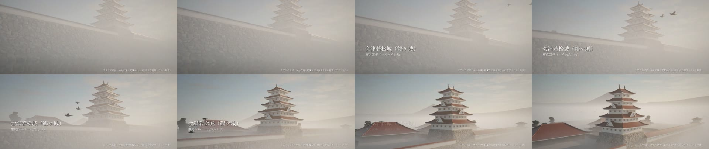

# 会津若松城（鶴ヶ城）1868 ― 映画風テストショット

「朝霧の中から、慶応四年（1868年）当時の会津若松城の天守が現れる」8秒のショットを、Blenderのスクリプト1本で作ります。外部の素材や有料サービスは使いません。

- 画面比率：2.39:1（シネスコ）、24fps、192コマ（8秒）
- 描く範囲：内堀の水面、本丸の石垣（野面積み）、天守台、五重の天守、走長屋、隅櫓、土塀、本丸御殿、松、朝霧、朝日、高い雲、遠景の山並みと磐梯山、霧の中を横切るカラス
- カメラ：南西の内堀の水面すれすれから、霧の中の石垣をなめるように約40mまで上昇し、霧の上に天守が現れる（焦点距離28→33mm、絞りF2.8→F5.6でピント送り）
- 大阪城のスクリプト（`../osaka-castle/`）とは独立していて、あちらは変更していません

## テスト映像

| ファイル | 内容 |
|---|---|
| `test/aizu_kiri_test_960x402.mp4` | 低解像度のテスト映像（960×402・24fps・8秒・無音）。題字と「推測を含む」の注記入り |
| `test/aizu_kiri_test_contact.jpg` | 1秒ごとのコマを並べた一覧 |



### 再生方法
- **Windows**：エクスプローラーで `aizu-castle\test\aizu_kiri_test_960x402.mp4` をダブルクリックすると、「メディア プレーヤー」で再生されます。
- **GitHub上**：リポジトリの `aizu-castle/test/` を開き、MP4ファイルを選んで「View raw」か「Download」を押します。ブラウザーで再生するか、PCに保存して再生します。
- **PCに取り込む**：`git pull` でこのブランチを取り込むと、同じ場所にファイルが入ります。

このテスト映像はクラウド環境のCPU（4コア・GPUなし）で描きました。960×402・32サンプルで、1コマ平均26.5秒（20.6〜39.5秒）、192コマで約85分かかりました。4Kの本番はGPU付きのPCで描く前提です。

## 環境調査の結果

| 項目 | 結果 |
|---|---|
| Windows 11のPC | このセッションからは接続できず、GPU・VRAM・CPU・メモリ・Blenderを確認できませんでした（接続できるPCが0台）。確認方法は下の「PCの性能を確かめる」にあります |
| 描画に使った環境 | クラウドのLinux環境。CPU 4コア、メモリ15GB、GPUなし |
| Blender | 4.2.23 LTS、4.5.15 LTS、5.2.3 LTS（Pythonモジュール版）。スクリプトは4.2と5.2で動作を確認 |
| 色の管理 | AgX（5.xではACES 2.0にも切り替え可） |
| 空 | 5.xは物理ベースの空（多重散乱）、4.xはNishita |

## 史料で確認できたことと、推測した部分

### 資料で確認できたこと
- 天守は外観五層。寛永16年（1639年）に五層へ改められたとされる（改築した城主は加藤明成とする資料と加藤嘉明とする資料がある）
- 壁は白亜（白漆喰）。屋根は鉄分を含む釉薬をかけた赤瓦で、寒さによる凍み割れを防ぐために採用された（採用は1643年説と1648年説がある）
- 天守台などの石垣は野面積みで、蒲生氏郷の時代のものが残るとされる
- 籠城戦は慶応4年8月23日（新暦1868年10月8日）から。このショットはその前、慶応4年8月10日（新暦9月25日）の朝として描いた。戦闘の場面は入れていない
- 天守は明治7年（1874年）に石垣を残して取り壊され、現在の天守は昭和40年（1965年）の再建
- 本丸には藩主の御殿があった
- 太陽の位置は、この日付と鶴ヶ城の緯度経度から計算した（日の出は地方時5時51分ごろ。ショットは日の出の約55分後で、太陽は方位99度・高度10度）
- 磐梯山の方角（城から北東約18km）は実際の地理に合わせた

### 推測で作った部分（史料で確認できず、古写真などとの照合が必要）

| 部分 | 内容 |
|---|---|
| 天守の寸法と比率 | 各重の幅・奥行・高さ、屋根の勾配と反り |
| 破風 | 千鳥破風を一・三重目の東西、二重目の南北に置いた位置と数 |
| 窓 | 数・大きさ・格子の形 |
| 鯱 | 形と材質（青銅色にした） |
| 軒裏・破風板 | 白漆喰で塗り込めた仕上げ |
| 天守の位置・天守台の高さ | 本丸の南辺近くに置き、天守台を高さ8mとした |
| 本丸の石垣・内堀 | 石垣の高さ16m、南側の堀幅約100m |
| 走長屋・隅櫓・土塀 | 天守の東に走長屋、南東隅に二重櫓、西に土塀を置いた配置（現在の復元建物を参考にした推定） |
| 本丸御殿 | 棟の数・大きさ・配置・屋根の仕上げ（赤瓦とした） |
| 石の色・大きさ | 石垣の石の色と大きさの分布 |
| 松 | 本数と位置 |
| 遠景 | 会津盆地を囲む山並みは簡略化（磐梯山の方角だけ実際に合わせた） |
| 霧 | 朝霧の濃さと高さは演出 |

テスト映像の右下にも「※天守の細部・本丸の建物配置などは推測を含む再現」と入れています。スクリプトの中でも、寸法などの設定に【資料】【推測】の印を付けました。Blenderで生成したシーンには、テキスト「AZ_考証メモ」としても書き出されます。

### 参考にした資料
- [鶴ヶ城（国土交通省 観光庁 多言語解説文）](https://www.mlit.go.jp/tagengo-db/common/001653699.pdf)
- [鶴ヶ城の歴史（ウォーカープラス）](https://www.walkerplus.com/article/1007360/)
- [鶴ヶ城の歴史（読売旅行）](https://www.yomiuri-ryokou.co.jp/magazine/article/tsurugajo_history/)
- [赤瓦の名城 鶴ヶ城（nippon.com）](https://www.nippon.com/ja/guide-to-japan/gu900324/)
- [鶴ヶ城（東北観光推進機構）](https://www.tohokukanko.jp/attractions/detail_1588.html)
- [会津戦争（国立国会図書館）](https://www.ndl.go.jp/scenery/column/tohoku/the_aizu_war.html)
- [会津鶴ヶ城旧天守閣 明治七年の写真（東北大学附属図書館）](https://touda.tohoku.ac.jp/collection/en/database/library/public/10010030000895)

次の段階では、明治初期の古写真と現在の天守・復元建物を並べて、天守の比率・破風・窓の位置を照合し、推測部分を減らすことを勧めます。

## 映像の作り方

| 要素 | 方法 |
|---|---|
| 描画 | Cycles。適応サンプリングとAIノイズ除去（OpenImageDenoise）で、少ないサンプルでも滑らかに |
| 光 | 物理ベースの空と太陽ライト。太陽は日付・時刻・緯度経度から計算した方位と高度 |
| 朝霧 | ボリューム。水面近くが濃く、上端（約27m）は大小のノイズで波打ち、東へゆっくり流れる。霧の中で何度も散った光は、濃さに比例した発光で近似（描画時間を抑えるため） |
| 逆光 | 太陽はカメラの右前方。前方散乱で太陽側の霧が金色に光り、天守や松の影が霧に落ちる |
| 石垣 | Voronoi で大石と間詰石を並べ、メッシュそのものを凹凸させる（4Kでは5cm間隔まで細かくなる）。石ごとの色、目地の暗がり、水際の濡れと苔、地衣類、雨の染み |
| 赤瓦 | 丸瓦の列、瓦1枚ずつの色の差、釉薬のつや、雨だれのくすみ |
| 空気遠近 | 霧の箱（6km四方）の薄いかすみと、遠くの山を空の色に溶かすシェーダー |
| カメラ | フルサイズ相当（センサー幅36mm）、Track To で注視点を追い、ごく小さな揺れを加える。被写界深度あり、ボケはわずかに縦長（アナモフィック風）。FINALではシャッター角180°のモーションブラー |
| 合成 | 光のにじみ（グレア）、レンズのわずかな歪みと色ずれ |
| 仕上げ（テスト映像） | ffmpegで、わずかなコントラストと暖色・寒色の調整、周辺減光、粒子、題字を加えた |

## 使い方（Windows 11）

### 1. 画面から使う
1. Blender 4.2 LTS以降（5.2 LTSを推奨）を開きます。
2. 上の「Scripting」タブを開き、テキストエディタで `aizu_wakamatsu_castle_1868.py` を開いて、▶（スクリプト実行）を押します。数秒でシーンができます。
3. 「レンダー」メニューの「アニメーションをレンダリング」で描画します。

画質はファイル先頭の `CFG["QUALITY"]` で切り替えます（最初は `"TEST"`）。画像はスクリプトの隣の `render\test\` などに保存されます。

### 2. コマンドで使う（PowerShell）
```powershell
cd C:\作業フォルダ\junior-profile\aizu-castle
$B = "C:\Program Files\Blender Foundation\Blender 5.2\blender.exe"   # 環境に合わせて変更

& $B -b -P aizu_wakamatsu_castle_1868.py -- --quality TEST --benchmark   # 3コマだけ描いて時間を測る
& $B -b -P aizu_wakamatsu_castle_1868.py -- --quality TEST --render      # 1280×536 で全192コマ
& $B -b -P aizu_wakamatsu_castle_1868.py -- --quality FINAL --benchmark  # 4K の時間を見積もる
& $B -b -P aizu_wakamatsu_castle_1868.py -- --quality FINAL --render --exr   # 4K 本番（16bit EXR）
```

| オプション | 内容 |
|---|---|
| `--quality TEST / PREVIEW / FINAL` | 1280×536 / 1920×804 / 3840×1608（4K） |
| `--benchmark` | 最初・中間・最後の3コマを描き、1コマの平均時間と全体の見込みを表示（`benchmark.txt` にも保存） |
| `--render` | 全コマを描く（1コマごとの時間は `timing.csv` に記録） |
| `--frames 1-48` | 描くコマの範囲 |
| `--device AUTO / GPU / CPU` | AUTOは、GPU（OptiX → CUDA → HIP → oneAPI → Metal の順）があれば使う |
| `--out フォルダ` | 出力先 |
| `--exr` | 16bitのOpenEXR（マルチレイヤー、深度・ミスト・霧の層つき）で書き出す。DaVinci Resolveでの色調整用 |
| `--save シーン.blend` | 生成したシーンを保存 |

### 品質の設定

| 品質 | 解像度 | 最大サンプル | 石垣の細かさ | モーションブラー | 出力 |
|---|---|---|---|---|---|
| TEST | 1280×536 | 64 | 16cm | なし | PNG 8bit |
| PREVIEW | 1920×804 | 160 | 10cm | あり | PNG 8bit |
| FINAL | 3840×1608 | 512 | 5cm | あり | PNG 16bit（または EXR） |

3840×1608は、4K（3840×2160）の画面に上下の黒帯を付けたシネスコの範囲です。書き出すときに4Kの画面に収めます（下の「仕上げ」）。

### 連番の画像を動画にする（ffmpeg）
```powershell
ffmpeg -framerate 24 -i render\test\aizu_kiri_%04d.png -c:v libx264 -crf 16 -pix_fmt yuv420p aizu_kiri_test.mp4
# 4K の画面（3840×2160）に上下の黒帯を付けて収める場合
ffmpeg -framerate 24 -i render\final\aizu_kiri_%04d.png -vf "pad=3840:2160:0:(oh-ih)/2" -c:v libx265 -crf 14 -pix_fmt yuv420p10le aizu_kiri_4k.mp4
```
色調整と題字は、DaVinci Resolve（無料版）で行うのがおすすめです。無料版は3840×2160まで書き出せます。

## PCの性能を確かめる

### PCの情報を調べる（PowerShell・読み取りのみ）
```powershell
Get-CimInstance Win32_VideoController | Select-Object Name, DriverVersion
Get-ItemProperty 'HKLM:\SYSTEM\ControlSet001\Control\Class\{4d36e968-e325-11ce-bfc1-08002be10318}\0*' -ErrorAction SilentlyContinue |
  Where-Object { $_.'HardwareInformation.qwMemorySize' } |
  ForEach-Object { "VRAM: {0} = {1:N1} GB" -f $_.DriverDesc, ($_.'HardwareInformation.qwMemorySize' / 1GB) }
(Get-CimInstance Win32_Processor).Name
"{0:N0} GB" -f ((Get-CimInstance Win32_ComputerSystem).TotalPhysicalMemory / 1GB)
Get-CimInstance Win32_LogicalDisk -Filter "DriveType=3" | ForEach-Object { "{0} 空き {1:N0} GB" -f $_.DeviceID, ($_.FreeSpace/1GB) }
```

### 描画時間の目安と、無理をしない進め方
1. まず `--quality TEST --benchmark` を実行して、1コマの時間を確かめます。
2. 次に `--quality FINAL --benchmark` で4Kの見込み時間を出します。数日以上かかるようなら、4Kの本番には進まず、下の改善策を検討します。
3. クラウド環境（CPU 4コア）での実測：TESTの75%（960×402・32サンプル）で1コマ平均26.5秒、8秒（192コマ）で約85分。4Kはこの約16倍の画素数で、サンプル数も16倍なので、全編をCPUで描くのは現実的ではありません。

| 起きること | 主な原因 | 改善策 |
|---|---|---|
| 1コマが非常に遅い | GPUが使われていない（CPUで描いている） | ログの「描画デバイス」を確認。Blenderの「編集 → プリファレンス → システム」でCycles のデバイス（OptiX / CUDA / HIP）を選ぶ。GPUドライバーを更新 |
| 途中で止まる・メモリ不足 | GPUメモリ（VRAM）が足りない | PREVIEW（1920×804）で描いてから4Kに拡大する。`QUALITY_PRESETS["FINAL"]["stone"]` を 0.05 → 0.08 にして石垣を軽くする。霧の範囲（`build_fog` の大きさ）を小さくする |
| 霧のちらつき・ざらつき | サンプル不足 | `samples` を上げる、`noise`（適応サンプリングのしきい値）を下げる |
| 霧が重い | ボリュームの計算 | 霧の濃さ（FogDensity）を下げる。FINALの `vol_bounces` を 1 → 0 にする |
| ディスクがいっぱい | 4KのEXR | 8秒で約10GB、60秒で約70〜100GB必要。PNGで書き出すか、別のドライブを `--out` で指定 |

## 調整できるところ

| 変えたいもの | 場所 |
|---|---|
| 天守の寸法・破風・屋根の反り | `TENSHU_LEVELS`、`ROOF_CURVE`・`ROOF_LIFT`・`TOP_LIFT` |
| 本丸・石垣・堀・天守台の寸法と位置 | `LAYOUT` |
| 本丸御殿の配置 | `GOTEN` |
| カメラの動き・レンズ・絞り | `CAM_KEYS`（フレーム、位置、注視点、焦点距離、F値） |
| 日付・時刻（日の出から何分後か） | `CFG["DATE"]`、`CFG["MIN_AFTER_SUNRISE"]` |
| 霧の高さ・濃さ・明るさ | 霧のマテリアルの `FogTop`・`FogDensity`・`FogGlow`・`HazeDensity` |
| 色の見え方 | `CFG["VIEW"]`（AgX / ACES 2.0）、`CFG["EXPOSURE"]` |

古写真などで推測部分を確かめたら、`TENSHU_LEVELS` や `LAYOUT` を直して、`ASSUMPTIONS` の一覧からも外してください。
